# Claude Build Day — Student Community Day México 2026
## Fase 1: Puesta a punto de Claude Code y conexión con AWS

| Rol | Mentor | Enfoque |
| :--- | :--- | :--- |
| **Fase 1 (Inicio)** | **Roberto Flores Segundo (Siegfried)** | Setup desde cero de Claude Code, AWS Nueva Experiencia y Agent Toolkit |
| **Fase 2 (Desarrollo)** | **Juan Mejía** | Creación y arquitectura de la aplicación web |
| **Fase 3 (Agentes)** | **Joselyn Lagunas** | Orquestación avanzada de flujos con agentes autónomos |

**Sede:** Instituto Politécnico Nacional (IPN) Santo Tomás, Ciudad de México.  
**Comunidad:** Student Community Day México 2026 / AWS Community LATAM.

---

## ¿De qué se trata esta primera fase?

¡Bienvenido al taller! En esta fase no perderás tiempo configurando servidores a mano, no descargarás archivos de claves secretas ni pelearás con la terminal. 

La meta de esta fase es que en **menos de 5 minutos** tengas tu agente de inteligencia artificial (**Claude Code**) instalado, enlazado a tu cuenta de **AWS** y con la conexión 100% validada a costo $0 USD para arrancar la construcción en la nube.

---

## Flujo express del taller (Copia, pega y construye)

```text
+---------------------------------------------------------------------------------------------------+
| 1. Claude Code en tu PC   2. Cuenta en AWS        3. Conectar a AWS       4. Validación $0 USD    |
|    - console.anthropic       - https://settings.aws  - Copiar prompt AWS     - Prompt de Ana Cunha|
|    - Organización + Créditos - Login social          - Pegar en Claude       - MCP Server activo  |
|    - Vincular vía /login     - Crear proyecto        - aws login (1 clic)    - Sesión confirmada  |
|                                                                                                   |
|                       ===> ¡LISTO PARA LA FASE 2 CON JUAN MEJÍA! <===                             |
+---------------------------------------------------------------------------------------------------+
```

---

### Paso 1: Configurar Claude Code en tu máquina

#### A. Cuenta y créditos de Anthropic (En tu navegador):
1. **Crear tu cuenta en Anthropic Console:**  
   Entra a [console.anthropic.com](https://console.anthropic.com) e inicia sesión seleccionando la opción **Organización** *(no cuenta personal)*:

   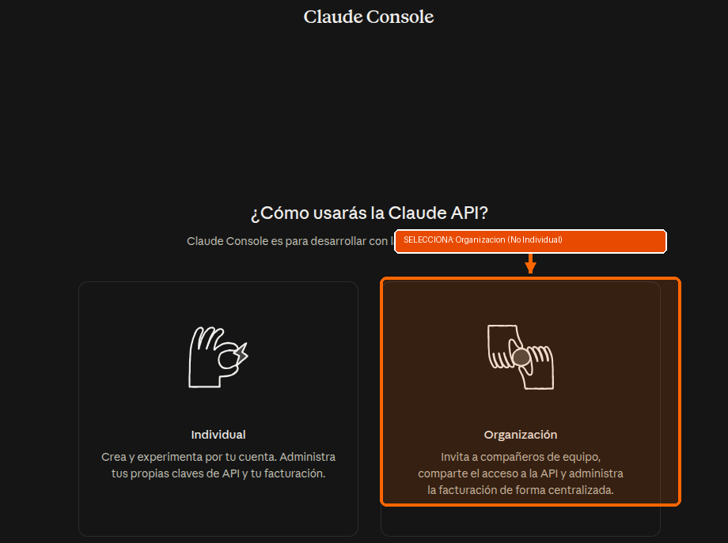

   > **[REGLA DE ORO]** No selecciones cuenta personal. Los cupones comunitarios de eventos solo aplican para organizaciones. Si ya tienes cuenta personal, conviértela a organización en *Organization settings*.

2. **Canjear tus créditos de cortesía del taller:**  
   Abre el enlace de canje entregado en el taller (*Claude Build Day at AWS Student Community Day*) y solicita tus créditos de API para tu organización:

   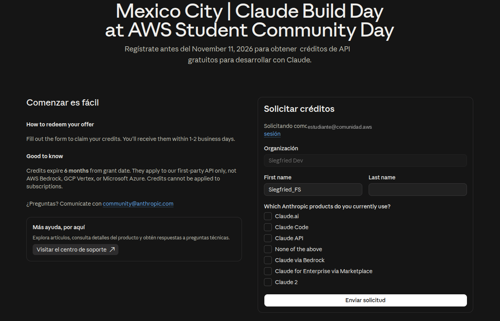

3. **Crear tu clave secreta (API Key) en Default workspace:**  
   En el menú lateral, ve a **API Keys** y crea tu clave secreta. Asegúrate de asignarle el ámbito **Default workspace**:

   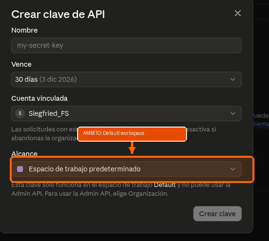

   > [!IMPORTANT]
   > ### ¿Por qué creamos la API Key y por qué en Default Workspace?
   > * **¿Por qué la API Key?:** Claude Code en terminal opera contra la API de Anthropic y descuenta su uso del monedero de tu Organización. Tu API Key es la credencial que amarra directamente la terminal con tu saldo de cortesía del evento.
   > * **¿Por qué Default Workspace?:** Si dejas el alcance global (`All workspaces`), Anthropic exige cabeceras HTTP adicionales (`anthropic-workspace-id`) que provocan rechazos de autenticación en terminal. En **Default workspace** la vinculación es directa y limpia.

---

#### B. Instalar Claude Code en tu terminal (Comando único todo-en-uno)

Abre tu terminal habitual, **copia la línea correspondiente a tu sistema operativo, pégala y pulsa Enter**.  
*(Este comando instala Claude, activa el `PATH` de inmediato en tu terminal abierta y lo guarda automáticamente para futuras sesiones, sin importar qué shell uses)*:

* **En Linux (Ubuntu, Debian, Mint, Fedora, Arch) o macOS (Terminal / iTerm2):**
  ```bash
  curl -fsSL https://claude.ai/install.sh | bash && export PATH="$HOME/.local/bin:$PATH" && (echo 'export PATH="$HOME/.local/bin:$PATH"' >> ~/.bashrc 2>/dev/null; echo 'export PATH="$HOME/.local/bin:$PATH"' >> ~/.bash_profile 2>/dev/null; echo 'export PATH="$HOME/.local/bin:$PATH"' >> ~/.zshrc 2>/dev/null; echo 'export PATH="$HOME/.local/bin:$PATH"' >> ~/.profile 2>/dev/null; true)
  ```

* **En Windows (PowerShell):**
  ```powershell
  Set-ExecutionPolicy -Scope Process -ExecutionPolicy Bypass; irm https://claude.ai/install.ps1 | iex; $env:Path = [System.Environment]::GetEnvironmentVariable("Path","User") + ";" + [System.Environment]::GetEnvironmentVariable("Path","Machine")
  ```

* **En Windows (Git Bash):**
  ```bash
  curl -fsSL https://claude.ai/install.sh | bash && export PATH="$HOME/.local/bin:$PATH" && (echo 'export PATH="$HOME/.local/bin:$PATH"' >> ~/.bash_profile 2>/dev/null; echo 'export PATH="$HOME/.local/bin:$PATH"' >> ~/.bashrc 2>/dev/null; true)
  ```

---

#### C. Crear la carpeta de tu proyecto y abrir Claude Code

Copia y pega este comando en tu terminal para crear tu espacio de trabajo y abrir el agente:

* **En Linux, macOS o Git Bash:**
  ```bash
  mkdir mi-proyecto && cd mi-proyecto && claude
  ```
* **En Windows (PowerShell):**
  ```powershell
  mkdir mi-proyecto; cd mi-proyecto; claude
  ```

Verás la pantalla de bienvenida con la versión oficial (v2.1.317):

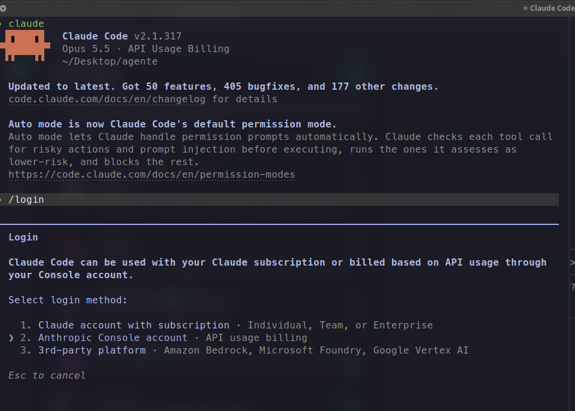

---

#### D. Vincular tu terminal con los créditos del evento (`/login`)

Para que Claude Code use los créditos comunitarios de tu Organización en lugar de pedirte tarjetas personales, tienes dos métodos:

##### Método 1: Vinculación web con 1 clic (Recomendado)
Dentro de Claude Code, escribe:
```text
/login
```
* **Paso crítico 1:** La terminal te mostrará opciones de cuenta. Selecciona:  
  👉 **`2. Anthropic Console account · API usage billing`**  
  *(¡NO elijas la opción 1 de suscripción Pro personal! Los créditos del taller están en Console).*
* **Paso crítico 2:** Selecciona:  
  👉 **`1. Sign in with your Console account (recommended)`**
* Se abrirá tu navegador web con la pantalla oficial de autorización:

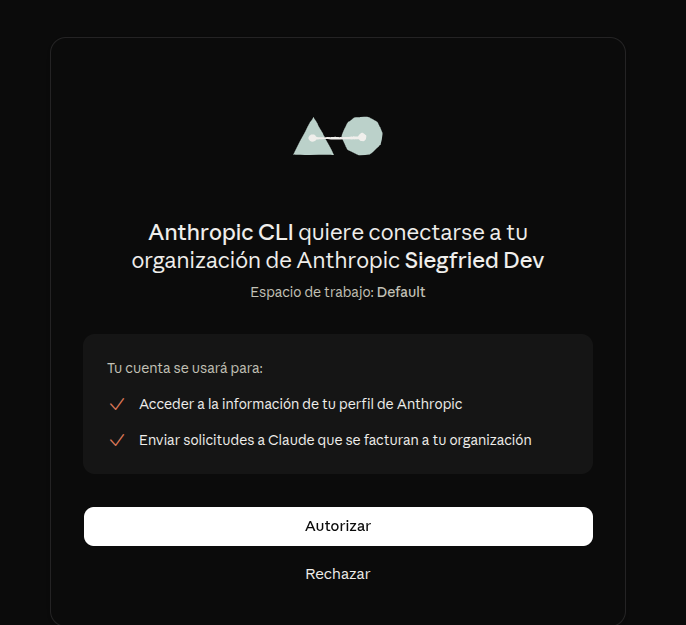

* Verifica que figure tu Organización (`Siegfried Dev` o el nombre que le diste) y pulsa el botón blanco **Autorizar**.

##### Método 2: Vinculación directa con tu API Key (Alternativa sin navegador)
Si estás en una terminal remota (SSH, WSL, Docker) o tu navegador no abre automáticamente, puedes enlazar tus créditos exportando tu API Key antes de arrancar Claude:
* **En Linux, macOS o Git Bash:**
  ```bash
  export ANTHROPIC_API_KEY="sk-ant-api03-tu-clave-aqui"
  ```
* **En Windows (PowerShell):**
  ```powershell
  $env:ANTHROPIC_API_KEY="sk-ant-api03-tu-clave-aqui"
  ```

*¡Tu Claude Code ya está enlazado a tus créditos y listo para conectarse a AWS!*

---

### Paso 2: Crear tu cuenta en AWS y tu primer proyecto (Nueva Experiencia)

Ahora abriremos tu entorno en la nube en tu navegador web:

1. **Ingresa a la URL oficial:** 👉 [https://settings.aws.com/](https://settings.aws.com/)
2. **Inicia sesión con tu cuenta social:** Elige **Google**, **GitHub**, **Apple** o **Amazon** (sin tarjetas bancarias):

   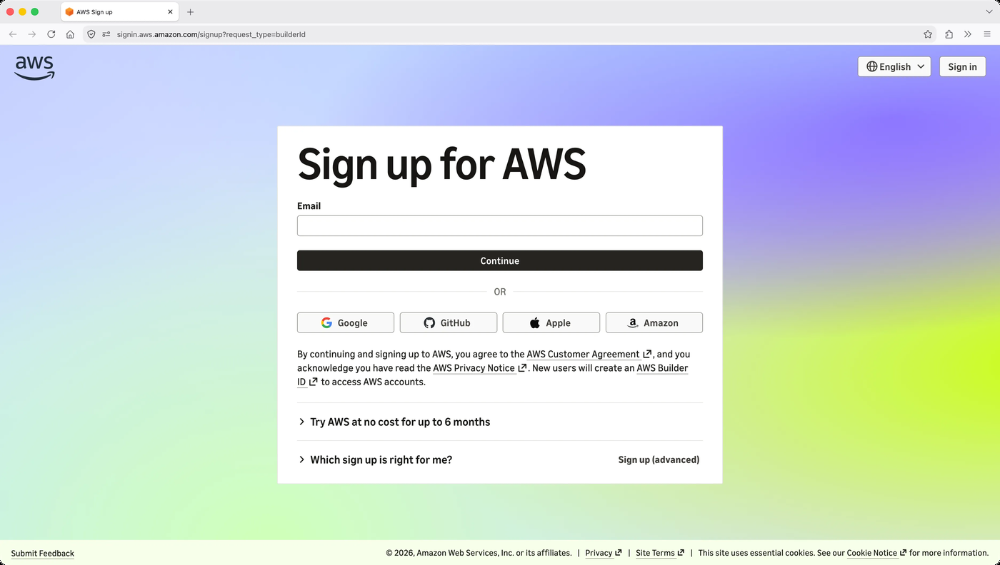

3. **Panel principal de Proyectos y Free Plan:**  
   Al entrar, verás tu panel de proyectos (`settings.aws.com/projects`) con tu primer proyecto creado y tus créditos de cortesía activos:

   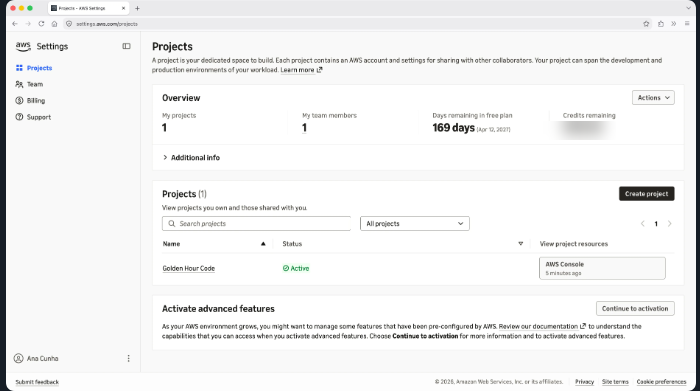

4. **Crear o renombrar tu proyecto:**  
   Haz clic en **Create project** (o usa el proyecto existente), asígnale un nombre (ej. `mi-proyecto`) y pulsa **Create**:

   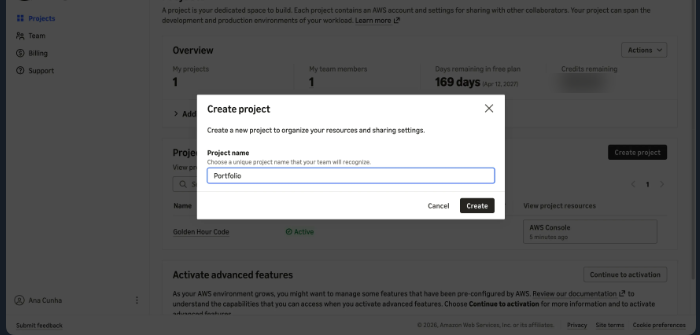

5. **Consola del proyecto y banner de Agent Toolkit:**  
   Haz clic en **AWS Console** al lado de tu proyecto para abrir la consola de trabajo (`Console Home`). En la parte superior verás el banner oficial del **Kit de herramientas de agentes para AWS**:

   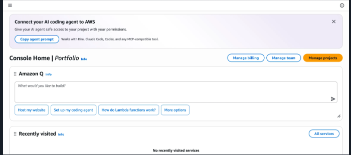

---

### Paso 3: Obtener la petición de AWS y conectarla a Claude Code

Con tu cuenta de AWS ya abierta en el navegador:

1. **Copiar el prompt oficial en el modal de AWS:**  
   En el banner de AWS, haz clic en **«Copy agent prompt»**. Se abrirá el modal interactivo con la petición oficial:

   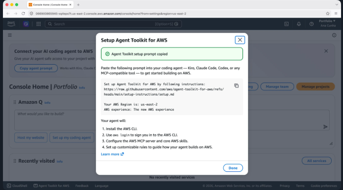

   Haz clic en el icono de copiar o copia este texto:

   ```text
   Configure el kit de herramientas de agentes para AWS siguiendo estas instrucciones:
   https://raw.githubusercontent.com/aws/agent-toolkit-for-aws/refs/heads/main/setup-instructions/setup.md
   ```

2. **Pegar en Claude Code:**  
   Regresa a tu terminal de Claude Code y pega el prompt:

   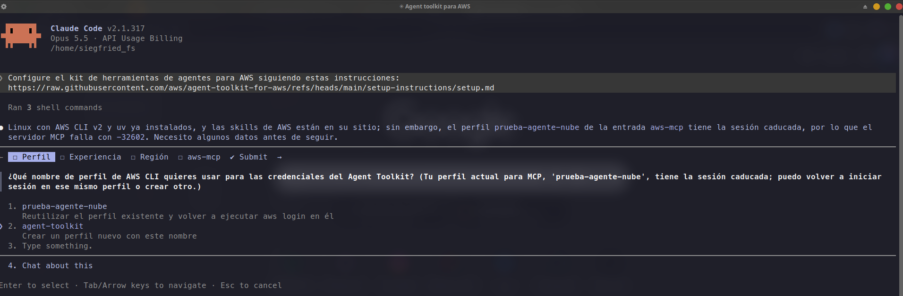

3. **Confirmar los 3 datos en terminal:**  
   * **Profile name:** Escribe `mi-proyecto` (o `default`).
   * **¿Nueva Experiencia de AWS?:** Responde **Sí**.
   * **Región de tu proyecto:** Selecciona **`us-east-1`** (o la de tu proyecto).
   * Si tenías perfiles previos, elige **«Añadirlo a la lista»**:

     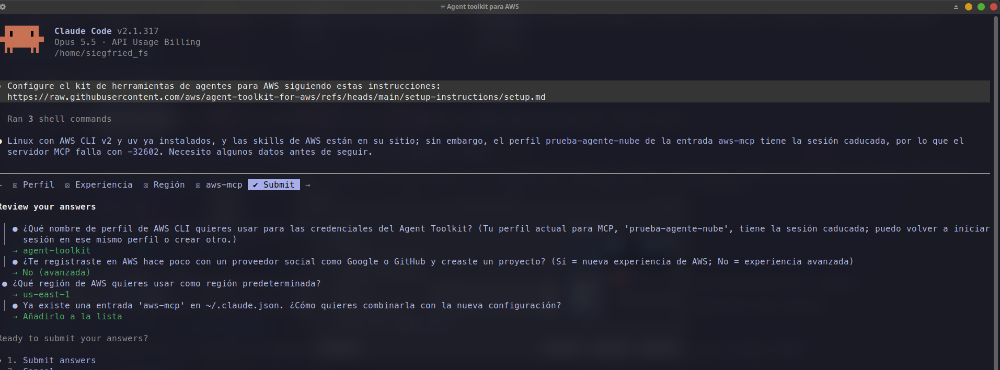

4. **Autorización web inmediata (`aws login`):**  
   Claude ejecutará `aws login` y abrirá una pestaña en tu navegador con la pantalla **Choose AWS sessions**.  
   Selecciona tu sesión activa y confirma:

   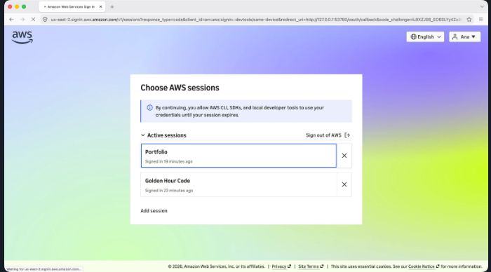

5. **Verificar conexión del MCP:**  
   En tu terminal de Claude Code, escribe `claude mcp list` y verás la confirmación verde:

   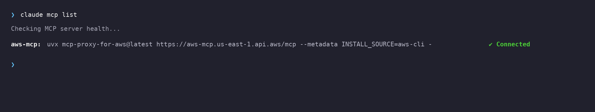

   ```text
   aws-mcp: ✔ Connected
   ```

---

### Paso 4: Validación de vinculación (Cero costo — El prompt de Ana Cunha)

Una vez autorizado el acceso en el navegador y verificado el servidor MCP, el último paso de la Fase 1 es confirmar que Claude Code se comunica fluidamente con tu cuenta de AWS sin generar ningún costo:

Pega en Claude Code el siguiente prompt:

```text
Check that the AWS MCP Server is connected and that I'm signed in to AWS. Confirm the Region configured for this project. Do not create or change any AWS resources.
```

Claude ejecutará la verificación e imprimirá en tu terminal una confirmación como esta:
* **AWS MCP Server:** `Connected`
* **AWS Sign-in:** Sesión activa confirmada con credenciales temporales
* **Región:** `us-east-1`
* **Recursos creados o modificados:** `None` ($0 USD gastados)

---

### ¡Felicidades! Fase 1 completada con éxito 🎉

Tu entorno de desarrollo está blindado, Claude Code está configurado y la vinculación con AWS está 100% comprobada y segura. 

**Entrega de estafeta:** Ahora tienes todo listo para la **Fase 2 con Juan Mejía**, donde comenzarán a tirar código e integrar Inteligencia Artificial en sus proyectos.

---

## Plan B y casos especiales

### ¿Qué pasa si no puedo usar la Nueva Experiencia o nos entregaron un voucher tradicional de AWS?
1. Entra a la consola tradicional de AWS.
2. Ve a **Billing and Cost Management** (Facturación y costos).
3. En el menú lateral izquierdo, haz clic en **Créditos (Credits)** -> **Canjear crédito (Redeem credit)**.
4. Escribe tu código promocional y aplícalo a tu cuenta:

   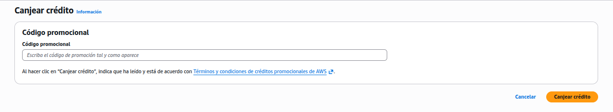

---

## Guías complementarias por sistema operativo

Para profundizar o resolver cualquier situación particular de tu laptop:

* [Guía para Windows (PowerShell, Git Bash y WSL2)](docs/windows.md)
* [Guía para Linux (Ubuntu, Debian, Mint, Fedora, Arch)](docs/linux.md)
* [Guía para macOS (Apple Silicon e Intel)](docs/macos.md)
* [Solución de errores frecuentes y planes de contingencia (Plan B)](docs/solucion-de-errores.md)
* [Cheatsheet de comandos rápidos](docs/cheatsheet.md)

---

## Scripts de diagnóstico rápido (5 segundos)

Verifica si tu computadora cumple con todos los requisitos antes del taller con nuestro script de validación incluido en `scripts/`:

* **En Linux / macOS / Git Bash:**
  ```bash
  ./scripts/check_env.sh
  ```
* **En Windows (PowerShell):**
  ```powershell
  .\scripts\check_env.ps1
  ```

---

## Agradecimientos y créditos de autoría

Este repositorio y la dinámica del taller se inspiran y fundamentan en el trabajo técnico y las guías publicadas por **Ana Cunha** en el **AWS Builder Center**:

* **Ana Cunha:** Developer Advocate y autora de la serie oficial *Build your website on AWS*.
* **Artículos de referencia utilizados:**
  * [How to connect your coding agent to AWS](https://builder.aws.com/content/3LKlKCv8mLiBiKLXVGTq0TKUdLR/how-to-connect-your-coding-agent-to-aws) — Por Ana Cunha (AWS Builder Center, octubre 2026).
  * [How to create your AWS account and first project](https://builder.aws.com/content/3K0hPixvikMqQ93vuL1Oyu5vym5/how-to-create-your-aws-account-and-first-project) — Por Ana Cunha (AWS Builder Center, octubre 2026).
