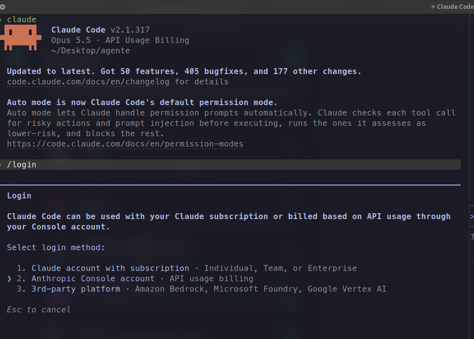
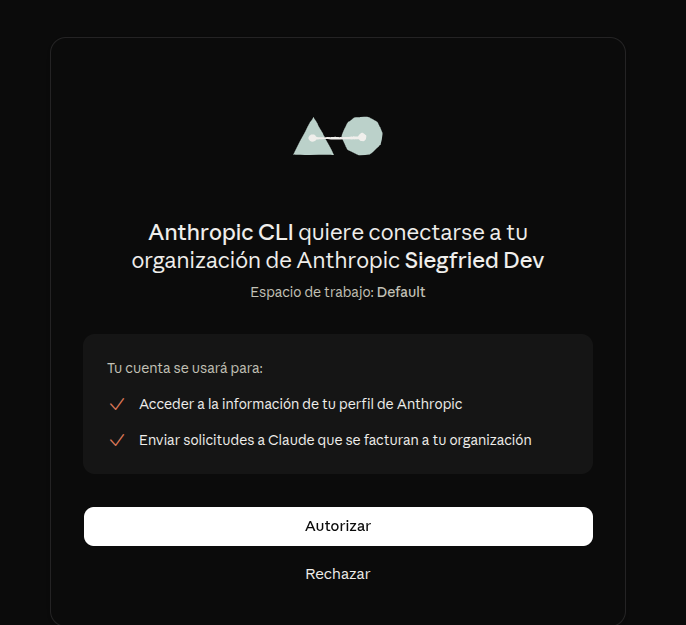
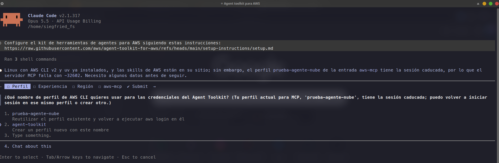
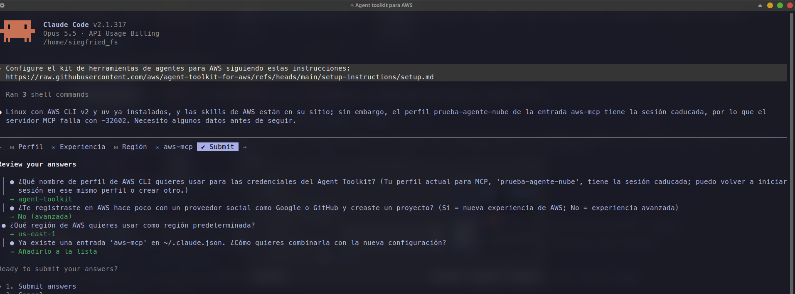
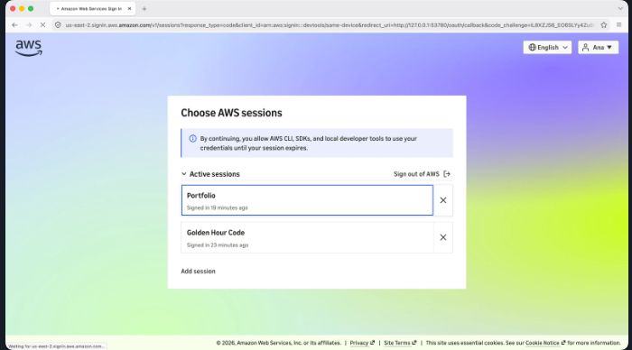

# Guía de puesta a punto para macOS (Apple Silicon M1/M2/M3/M4 e Intel)
## Claude Build Day @ Student Community Day México 2026

> **Mentor de Fase 1:** Roberto Flores Segundo (Siegfried)  
> **Filosofía del taller:** Cero comandos manuales innecesarios. Copia, pega y a tirar código.

---

## Paso 1: Instalar Claude Code y activar PATH (Comando único de 1 línea)

Abre **Terminal** (o iTerm2), copia y pega este comando único.  
*(Descarga e instala Claude Code de forma nativa para tu arquitectura Mac M1-M4 o Intel, activa el comando `claude` en caliente y lo guarda para siempre tanto en Zsh como en Bash de macOS)*:

```bash
curl -fsSL https://claude.ai/install.sh | bash && export PATH="$HOME/.local/bin:$PATH" && (echo 'export PATH="$HOME/.local/bin:$PATH"' >> ~/.zshrc 2>/dev/null; echo 'export PATH="$HOME/.local/bin:$PATH"' >> ~/.bash_profile 2>/dev/null; echo 'export PATH="$HOME/.local/bin:$PATH"' >> ~/.profile 2>/dev/null; true)
```



> [!NOTE]
> *(Opcional)* Si prefieres usar Homebrew: `brew install --cask claude-code`.

---

## Paso 2: Crear la carpeta de tu proyecto y abrir Claude Code

Copia y pega para crear tu espacio de trabajo y lanzar el agente en un solo paso:

```bash
mkdir mi-proyecto && cd mi-proyecto && claude
```

---

## Paso 3: Vincular tu terminal con los créditos del evento (`/login` o API Key)

> [!IMPORTANT]
> ### ¿Por qué creamos la API Key y cómo se vinculan los créditos?
> Claude Code opera contra la API de Anthropic y descuenta su uso del monedero de tu **Organización**. Para vincular tu terminal con los créditos del taller tienes dos caminos:

### Método 1: Vinculación web con 1 clic (Recomendado)
Dentro de la terminal de Claude Code, escribe:

```text
/login
```
* **Selecciona:** **`2. Anthropic Console account · API usage billing`**  
  *(¡Crucial! No elijas la opción 1 de suscripción Pro personal; los créditos del evento están en tu cuenta de Console).*
* **Selecciona:** **`1. Sign in with your Console account (recommended)`**
* Se abrirá Safari o Google Chrome para autorizar con tu cuenta y la Organización del evento:



* Verifica que figure tu Organización y pulsa el botón blanco **Autorizar**.

### Método 2: Vinculación directa con tu API Key (Sin navegador)
Si prefieres enlazar tu terminal directamente o tienes extensiones restrictivas en Safari, exporta tu API Key en Terminal antes de abrir Claude:
```bash
export ANTHROPIC_API_KEY="sk-ant-api03-tu-clave-aqui"
```

---

## Paso 4: Conectar a AWS con el prompt oficial (Automatización total)

> [!NOTE]
> **No necesitas instalar AWS CLI ni uv a mano en macOS.**  
> El propio agente revisa qué tienes instalado; si te falta alguna herramienta o tu versión de AWS CLI está desactualizada, el agente te lo notifica y la instala o actualiza de forma autónoma.

En tu terminal de Claude Code, pega este prompt exacto copiado desde la consola de AWS:

```text
Configure el kit de herramientas de agentes para AWS siguiendo estas instrucciones:
https://raw.githubusercontent.com/aws/agent-toolkit-for-aws/refs/heads/main/setup-instructions/setup.md
```



**Responde las 3 preguntas breves que te hará el agente:**
1. **Profile name:** `mi-proyecto` (o `default`).
2. **¿Nueva Experiencia de AWS?:** Responde **Sí**.
3. **Región de tu proyecto:** Tu región en AWS (ejemplo: **`us-east-1`**, consulta la información adicional de tu proyecto en AWS Settings).
4. Si tenías perfiles previos, elige **«Añadirlo a la lista»**.



Cuando el agente ejecute `aws login`, se abrirá Safari o Chrome: selecciona tu sesión activa y pulsa **Autorizar**:



---

## Paso 5: Validar la vinculación con AWS (Cero costo — El prompt de Ana Cunha)

Antes de pasar a construir, confirma que la conexión a AWS y el servidor MCP están activos sin crear recursos ni consumir saldo:

```text
Check that the AWS MCP Server is connected and that I'm signed in to AWS. Confirm the Region configured for this project. Do not create or change any AWS resources.
```

El agente responderá confirmando:
* **Servidor MCP:** `Connected`
* **Sesión:** `Signed in` con credenciales temporales
* **Región:** `us-east-1` (o la configurada)
* **Recursos creados o modificados:** `None` ($0 USD gastados)

---

## ¡Fase 1 completada con éxito! 🎉

Tu entorno macOS está listo y verificado. Ahora entregamos la estafeta a **Juan Mejía (Fase 2)** para comenzar con el desarrollo e integración de Inteligencia Artificial en tus proyectos.

---

## Incidencias frecuentes en macOS

* **`zsh: command not found: claude`:**  
  Corre de inmediato: `export PATH="$HOME/.local/bin:$PATH"` o ejecuta directamente `~/.local/bin/claude`.
* **Alerta de desarrollador no verificado (Gatekeeper):**  
  Si macOS bloquea el instalador de AWS CLI descargado, ve a **Ajustes del Sistema -> Privacidad y seguridad** y pulsa en **Permitir de todos modos** (o haz clic derecho sobre el archivo -> **Abrir**).
* **Si el WiFi del auditorio bloquea descargas:**  
  Conecta la memoria USB del evento y haz doble clic en **`AWSCLIV2.pkg`** para instalar AWS CLI sin conexión a internet.
