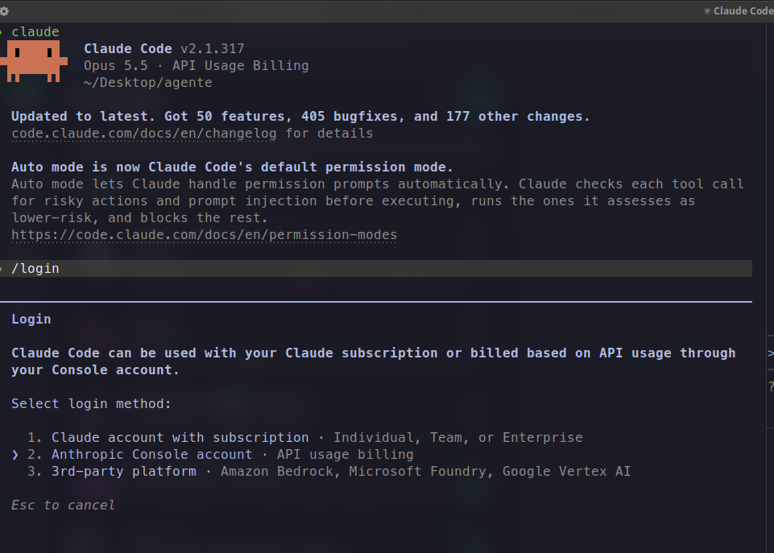
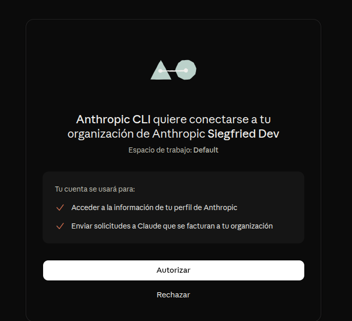
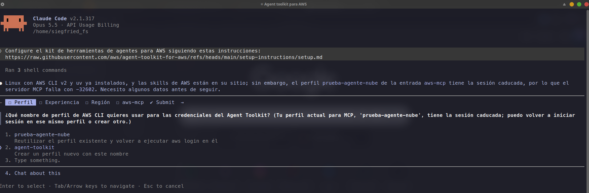
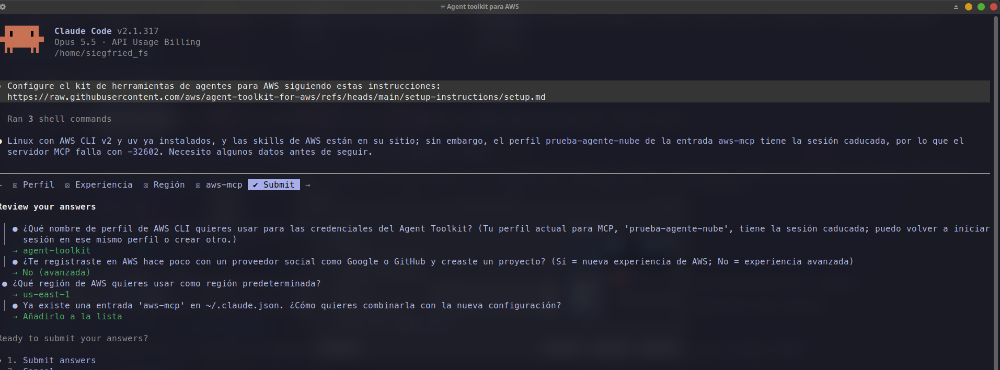
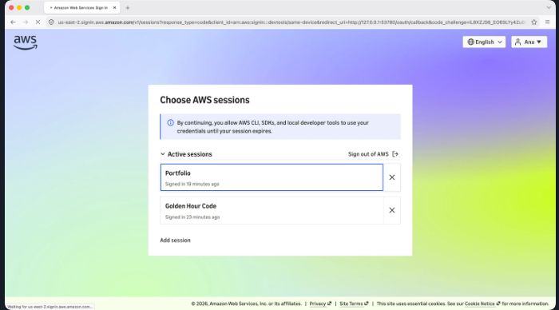

# Guía de puesta a punto para Windows (PowerShell nativo, Git Bash y WSL2)
## Claude Build Day @ Student Community Day México 2026

> **Mentor de Fase 1:** Roberto Flores Segundo (Siegfried)  
> **Filosofía del taller:** Cero comandos manuales innecesarios. Copia, pega y a tirar código.

---

## Paso 1: Instalar Claude Code y activar PATH (Comando único)

Elige tu terminal preferida y copia una sola línea:

### Opción A: En PowerShell nativo (Recomendado para la mayoría)
Abre **PowerShell** (tecla Windows -> escribe `PowerShell`), pega esta sola línea y pulsa Enter.  
*(Habilita ejecución de scripts, instala Claude Code de forma nativa y recarga la variable PATH en caliente en esa misma ventana para que funcione de inmediato)*:

```powershell
Set-ExecutionPolicy -Scope Process -ExecutionPolicy Bypass; irm https://claude.ai/install.ps1 | iex; $env:Path = [System.Environment]::GetEnvironmentVariable("Path","User") + ";" + [System.Environment]::GetEnvironmentVariable("Path","Machine")
```



---

### Opción B: En Git Bash (Para amantes de Bash en Windows)
Abre **Git Bash**, pega esta sola línea y pulsa Enter.  
*(Descarga el instalador, activa el PATH en la sesión actual y lo deja guardado para siempre en tus perfiles de Git Bash)*:

```bash
curl -fsSL https://claude.ai/install.sh | bash && export PATH="$HOME/.local/bin:$PATH" && (echo 'export PATH="$HOME/.local/bin:$PATH"' >> ~/.bash_profile 2>/dev/null; echo 'export PATH="$HOME/.local/bin:$PATH"' >> ~/.bashrc 2>/dev/null; true)
```

> [!CAUTION]
> **No uses la consola tradicional CMD (`cmd.exe`).** No reconoce comandos modernos como `irm`. Usa siempre **PowerShell** o **Git Bash**.

---

## Paso 2: Crear la carpeta de tu proyecto y abrir Claude Code

Copia y pega este comando en tu terminal para crear tu espacio de trabajo y lanzar el agente en un solo paso:

* **En PowerShell:**
  ```powershell
  mkdir mi-proyecto; cd mi-proyecto; claude
  ```
* **En Git Bash:**
  ```bash
  mkdir mi-proyecto && cd mi-proyecto && claude
  ```

---

## Paso 3: Vincular tu terminal con los créditos del evento (`/login` o API Key)

> [!IMPORTANT]
> ### ¿Por qué creamos la API Key y cómo se vinculan los créditos?
> Claude Code opera contra la API de Anthropic y descuenta su uso del monedero de tu **Organización**. Para vincular tu terminal con los créditos del taller tienes dos caminos:

### Método 1: Vinculación web con 1 clic (Recomendado)
Dentro de la terminal de Claude Code, escribe:

```text
/login
```
* **Selecciona:** **`2. Anthropic Console account · API usage billing`**  
  *(¡Crucial! No elijas la opción 1 de suscripción Pro personal; los créditos del evento están en tu cuenta de Console).*
* **Selecciona:** **`1. Sign in with your Console account (recommended)`**
* Se abrirá Edge o Google Chrome para autorizar con tu cuenta y la Organización del evento:



* Verifica que figure tu Organización y pulsa el botón blanco **Autorizar**.

### Método 2: Vinculación directa con tu API Key (Sin navegador)
Si prefieres enlazar tu terminal directamente o estás usando WSL/Git Bash:
* **En PowerShell:**
  ```powershell
  $env:ANTHROPIC_API_KEY="sk-ant-api03-tu-clave-aqui"
  ```
* **En Git Bash:**
  ```bash
  export ANTHROPIC_API_KEY="sk-ant-api03-tu-clave-aqui"
  ```

> **[AVISO DE FIREWALL EN WINDOWS]**  
> Si Windows Defender te muestra una ventana emergente preguntando si deseas permitir que Claude acceda a redes, haz clic en **Permitir acceso (Allow access)**.

---

## Paso 4: Conectar a AWS con el prompt oficial (Automatización total)

> [!NOTE]
> **No necesitas instalar AWS CLI ni uv a mano en Windows.**  
> El propio agente revisa qué tienes instalado; si te falta alguna herramienta o tu versión de AWS CLI está desactualizada, el agente te lo notifica y la instala o actualiza de forma autónoma.
> *(Si el instalador de AWS CLI en Windows solicita permisos de administrador mediante una ventana de Control de cuentas de usuario UAC, pulsa **Sí**).*

En tu terminal de Claude Code, pega este prompt exacto copiado desde la consola de AWS:

```text
Configure el kit de herramientas de agentes para AWS siguiendo estas instrucciones:
https://raw.githubusercontent.com/aws/agent-toolkit-for-aws/refs/heads/main/setup-instructions/setup.md
```



**Responde las 3 preguntas breves que te hará el agente:**
1. **Profile name:** `mi-proyecto` (o `default`).
2. **¿Nueva Experiencia de AWS?:** Responde **Sí**.
3. **Región de tu proyecto:** Tu región en AWS (ejemplo: **`us-east-1`**, consulta la información adicional de tu proyecto en AWS Settings).
4. Si tenías perfiles previos, elige **«Añadirlo a la lista»**.



Cuando el agente ejecute `aws login`, se abrirá tu navegador web: selecciona tu sesión activa y pulsa **Autorizar**:



---

## Paso 5: Validar la vinculación con AWS (Cero costo — El prompt de Ana Cunha)

Antes de pasar a construir, confirma que la conexión a AWS y el servidor MCP están activos sin crear recursos ni consumir saldo:

```text
Check that the AWS MCP Server is connected and that I'm signed in to AWS. Confirm the Region configured for this project. Do not create or change any AWS resources.
```

El agente responderá confirmando:
* **Servidor MCP:** `Connected`
* **Sesión:** `Signed in` con credenciales temporales
* **Región:** `us-east-1` (o la configurada)
* **Recursos creados o modificados:** `None` ($0 USD gastados)

---

## ¡Fase 1 completada con éxito! 🎉

Tu entorno Windows está listo y verificado. Ahora entregamos la estafeta a **Juan Mejía (Fase 2)** para comenzar con el desarrollo e integración de Inteligencia Artificial en tus proyectos.

---

## Matriz de solución de problemas frecuentes en Windows

| Síntoma en pantalla | Causa raíz | Solución inmediata |
| :--- | :--- | :--- |
| **`La ejecución de scripts está deshabilitada en este sistema`** | Política de PowerShell restrictiva. | Ejecuta: `Set-ExecutionPolicy -Scope Process -ExecutionPolicy Bypass` y vuelve a correr el comando. |
| **`'claude' no se reconoce como un comando...`** | La ventana de PowerShell no ha recargado el PATH. | Cierra la ventana y abre una nueva de PowerShell, o recarga el PATH con el comando en caliente. |
| **`'irm' no se reconoce como un comando...`** | Estás en la consola CMD tradicional (`cmd.exe`). | Abre **PowerShell** o **Git Bash**. |
| **`Could not create SSL/TLS secure channel`** | PowerShell 5.1 antiguo en Windows 10 sin TLS 1.2 activo. | Ejecuta: `[Net.ServicePointManager]::SecurityProtocol = [Net.SecurityProtocolType]::Tls12` antes del `irm`. |
| **En WSL2 `aws login` no abre el navegador** | WSL no tiene puente gráfico hacia el navegador de Windows. | Ejecuta dentro de WSL: `aws login --region us-east-1 --profile mi-proyecto --remote` y copia el enlace en Edge/Chrome. |
| **UAC pide permisos de Administrador durante el setup** | El agente está instalando el MSI oficial de AWS CLI v2. | Haz clic en **Sí** para permitir la instalación. |
| **Si la red del auditorio bloquea la descarga del instalador** | Firewall o WiFi saturado. | Conecta la memoria USB del evento e instala manualmente haciendo doble clic en **`AWSCLIV2.msi`**. |
